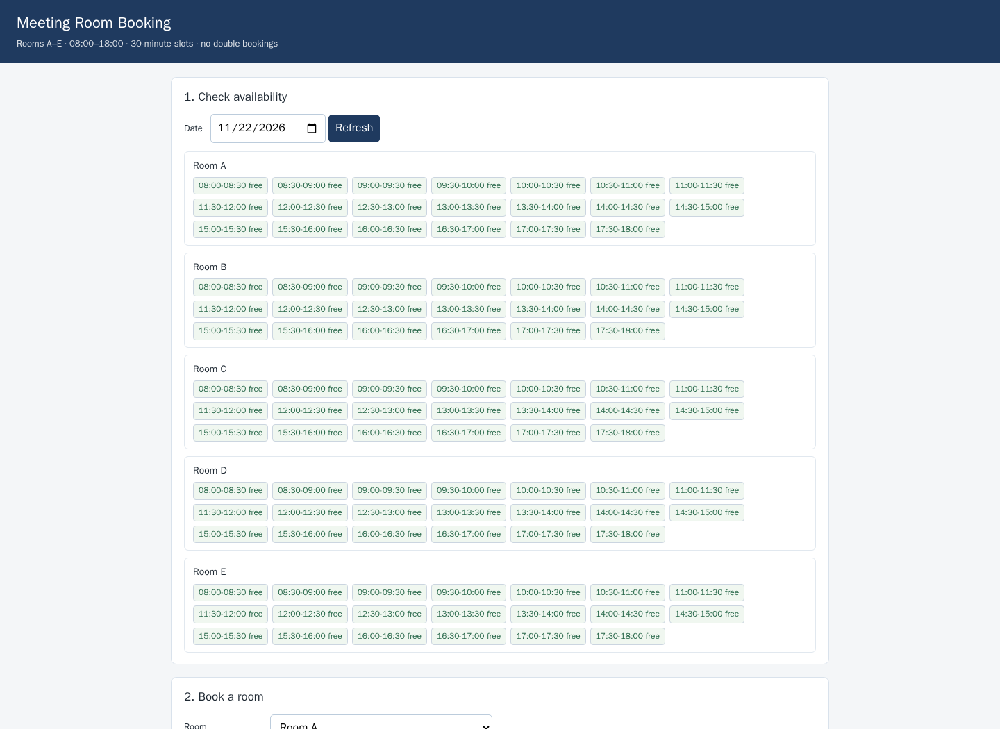
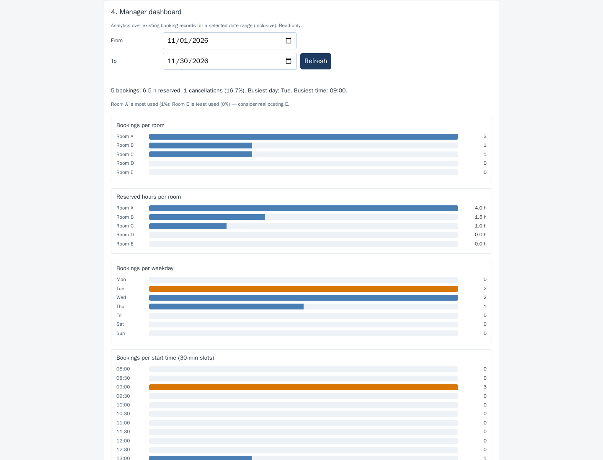
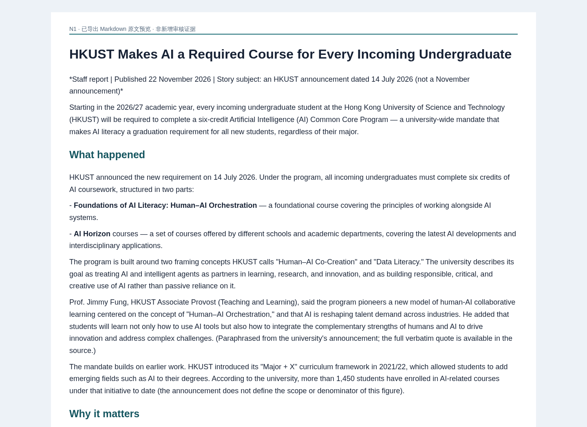
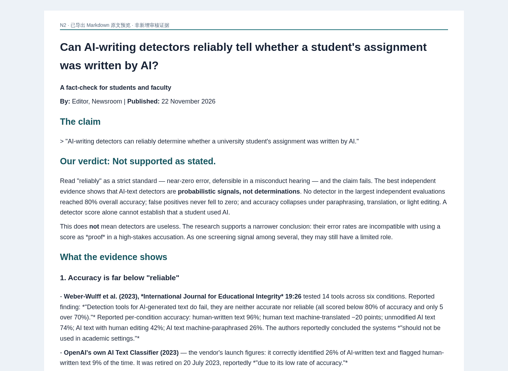
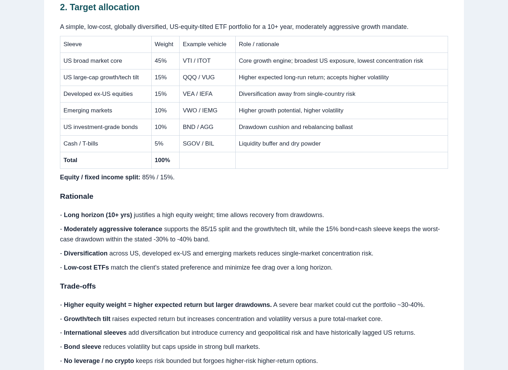
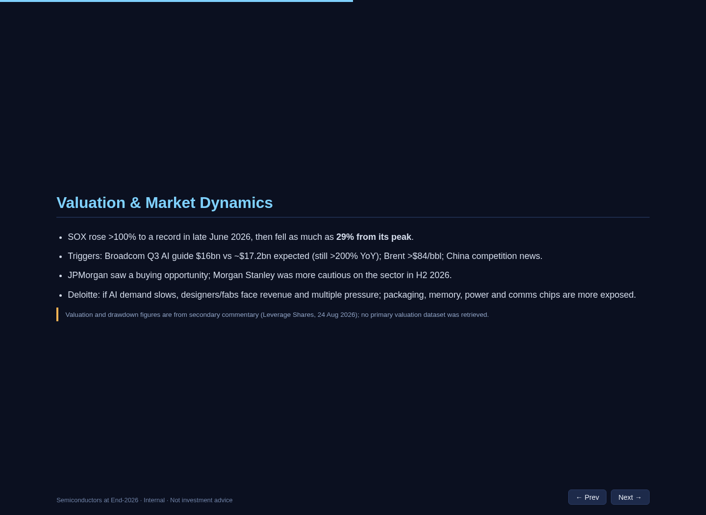

# EvoMAC 多智能体协作平台 · 8099 Mid-Test 归档版

本分支保存 2026-11-23 本地 **8099 队友版及后续轮次收尾修改**，以及用户手动运行的六项 Mid-Test 最新成果。Software、Newsroom、Fund 分别使用独立团队数据、角色记忆和工作区。

## 本轮六题结果与下载

状态依据实际运行记录；不是教师评分。“任务 done”“候选包 candidate”“正式包 packaged”分别记录，不互相替代。

| 任务 | 最新结果 | 交付包 | 核心成果与限制 |
|---|---|---|---|
| [S1 会议室预约](reports/midtest-8099-20261123/S1/) | done | [正式包 ZIP](reports/midtest-8099-20261123/S1/delivery.zip) | 预约、查询、取消、浏览器本地持久化 |
| [S2 使用量看板](reports/midtest-8099-20261123/S2/) | partial | [候选包 ZIP](reports/midtest-8099-20261123/S2/delivery.zip) | 已发布核心统计曾通过 11/11 浏览器断言；后续私有修补未重发，独立 QA 和正式发布未完成 |
| [N1 校园 AI 新闻](reports/midtest-8099-20261123/N1/) | done | [正式包 ZIP](reports/midtest-8099-20261123/N1/delivery.zip) | 报道、newsletter、social 与发布说明 |
| [N2 检测器事实核查](reports/midtest-8099-20261123/N2/) | done | [最终文章下载包](reports/midtest-8099-20261123/N2/delivery.zip)，平台 candidate | 可下载核查稿；包类型与任务完成状态分开说明 |
| [F1 模拟投资方案](reports/midtest-8099-20261123/F1/) | 人工标记 done；原始 partial | [正式包 ZIP](reports/midtest-8099-20261123/F1/delivery.zip) | 方案、风险、客户介绍均已产出；仅打包阶段重复审核关联导致原 partial，按用户要求调整并保留审计 |
| [F2 半导体 HTML 演示](reports/midtest-8099-20261123/F2/) | done | [最终展示包 ZIP](reports/midtest-8099-20261123/F2/delivery.zip)，平台 candidate | 可离线逐页展示的 HTML 幻灯片及说明；不声称已发生平台正式发布 |

[机器可读汇总](reports/midtest-8099-20261123/index.json)。每题目录含已发布产物、ZIP 原件、解压文件、运行/审核/测试证据和截图。`run-evidence.json` 保留导出时原始状态，F1 的人工调整另见 `status-adjustment.json`，未伪造测试或独立验收。

六题取各自最新一次实际运行，不拼接不同尝试的成功片段。S2 的私有、未发布补丁不混入下载包。没有因本次整理重新调用模型跑六题，也没有编辑生成产品的业务代码。

## 产物预览

### S1 · 预约系统



### S2 · 管理看板



图中使用该次已记录测试的合成输入，仅用于展示图表；[空数据原始界面](reports/midtest-8099-20261123/S2/preview.png) 和 [样例来源](reports/midtest-8099-20261123/S2/preview-fixture.json) 一并保留。

### N1 / N2 · 新闻与事实核查





以上是导出的 Markdown 原文预览，便于阅读，不冒充独立验收截图。

### F1 · 模拟配置方案



### F2 · 半导体 HTML 演示



## 系统与本版修改

- 使用任务 DAG、显式产物授权和 Docker 工具执行；支持 Software、Newsroom、Fund、Exam 及自设团队。
- 每个 Agent 独立保存执行经历、候选经验和已确认策略，按团队、角色和会话隔离。记录经验不等于已证明性能提升，需查看实际采用及后续结果。
- 同组后续任务继承前序已发布快照及上下文；是否真的阅读和使用，须以工具记录为准。S2 会读取 S1 的预约数据接口。
- 本版新增可配置的 **15＋8 动作预算**，不是测试次数。先给每子任务/修订 15 轮，未以有效 final 完成才追加一次 8 轮，第 23 轮仅允许 final。第 12 轮起提示收尾。
- 第 20 轮起停止新增网络搜索、抓取与委派。文件制作任务按实际写入/发布回执，提示“先写必需文件→发布→final”，并提供真实路径的顶层发布示例；未产出/发布时停止继续读取和测试，预留格式纠错机会。
- 文字回复、finalSummary、显式 reviewOf 审核、delivery 子任务不被新增规则强迫写文件；原权限、审核和契约保持有效。
- 终态不再仅因 delivery 打包子任务缺少第二次独立审核而降级；产品审核、当前文件和包完整性检查仍保留。
- 最后汇总仍为只读。若规划漏掉实际打包任务，仅靠汇报文字不能生成 ZIP。本版**不包含已回滚的 Fund 强制打包计划校验**。

该分支基于队友版本合并；此前另一分支上的 Dev/403 等修复不应被认为全部已移植。仅以上代码和实际运行记录为准。

## 启动与配置

需要 Python 3.11+、Docker CLI/daemon 和已构建的浏览器镜像。复制 `.env.example` 为 `.env`，各成员在本地私下填写课程模型密钥和 SerpAPI 密钥。源码、交付包和报告不含这些密钥。

```bash
cp .env.example .env
# 编辑 .env，填写 LLM_API_KEY 和 SERPAPI_API_KEY
# 预先准备 python:3.11-alpine，并构建本机浏览器镜像
docker build -t evo-agent-browser:1.64.1 docker/browser
python -m backend.server --time-only --port 8099
```

本轮使用 HKGAI `t2_hkgai-v3_fp8_1m_e7`，compatible 传输、disabled thinking、JSON action 模式；见配置模板。搜索通过 SerpAPI，读取正文仍是独立抓取步骤，可能遇到 403/404 或重定向问题。

```dotenv
AGENT_INITIAL_TURNS=15
AGENT_EXTRA_TURNS=8
```

设 `AGENT_INITIAL_TURNS=0` 关闭新增轮次策略。`--time-only` 保留每任务运行的 30 分钟墙钟总时限，不限制累计调用/Token，但启用上述策略时子任务动作仍受 15＋8 限制。新预算适用于所有新建执行任务，含自设期末测试团队；普通聊天不适用。返工按新修订计轮，总时限不重置。

本地 8099 实际通过独立 Docker 控制器、命名卷和只读配置挂载启动。Windows 用户应使用 Docker/WSL 环境；控制器调用主机 Docker 时，源码、工作区和 browser runner 必须位于主机可见的同路径挂载，不能直接将仅存在于控制器内的 `/source` 传给子容器。不要将 `.runtime`、SQLite、真实 `.env` 或密钥上传仓库。

## 验证与实际限制

最近一次收尾修改运行了 31 项相关离线检查，并补充了文字/审核任务边界检查；覆盖写入→错误发布格式→纠正发布→final 的 23 轮链路。完整历史回归并非全绿：原 ZIP 的四角色集成用例也曾出现等待时限/上下文问题，不能用历史 README 的测试总数代替本次验证。

本次归档额外校验包内路径、ZIP 完整性、源码语法和已知密钥扫描，并实际打开导出的 HTML/原文预览生成截图。截图不等于重新完成所有业务验收。S2 仍有独立验收及未发布修补的缺口；F1 的完成标签有明确人工调整；N2/F2 的最终展示下载包仍是平台候选类型。

模拟投资与行业展望产物是课程实验材料，包含来源、时点、预测及证据范围限制，未在归档中重新核验市场事实。请结合原始证据理解，不把流程 done 等同于金融结论正确。

## 历史记录

旧版本的长篇运行记录和设计说明保存在 [历史 README](docs/archive/README-before-8099.md)。其中历轮 R12/R13 结论和测试数量属于历史，不能当作本次 8099 六题结果。
