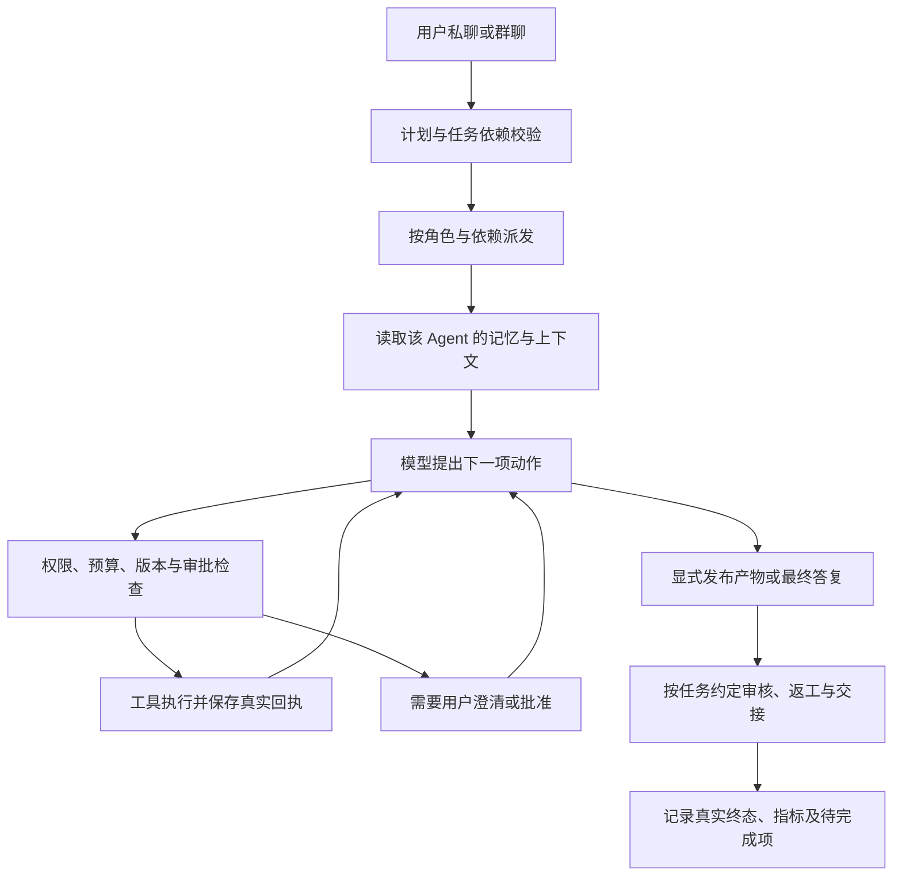

# 平台架构与能力边界

本文件描述当前代码结构；真实任务的能力与缺口见[项目状态报告](project-status-2026-11-16.md)。接口存在、离线测试通过、真实模型完成任务和产品通过独立检查是不同层次的证据。

## 请求、协作与任务生命周期

前端通过 `backend/server.py` 的 HTTP 服务访问 `TeamHub`。各团队有自己的 `Platform`、持久状态和 Agent 注册表；内置通用、软件、新闻和基金团队。当前 HTTP 界面使用这些团队配置，不提供任意团队的可视化创建器。

`backend/engine.py` 负责私聊、群聊、任务计划及执行。负责人通过模型输出任务依赖图；平台校验参与者、能力、依赖关系和输出约束后派发任务。成员可发送消息、创建委派子任务、等待子任务或拒接；依赖、当前占用和工具权限参与调度。明确指定角色的计划会收窄候选成员，角色协商仍有改进空间。

`done`、`partial`、`failed` 等状态均保留；平台不以生成文字或创建 ZIP 自动推断业务成功。模型调用、实际工具执行和被拒绝的动作提案分别记录。服务重启后保留执行现场，未确认的外部操作不自动重放。

## 每个 Agent 的记忆与学习

`backend/memory.py` 通过持久化仓库保存各所有者的记忆，并区分私聊、群聊和显式共享范围。`backend/learning.py` 从真实执行中记录失败事实、提出候选经验、在后续任务检索并注入上下文，再核验是否实际采纳以及结果是否支持确认。未经验证的候选不会直接成为已证实策略。

学习不是修改模型参数，也不是把每条反思当成成功经验。目前自动确认覆盖有限的流程模式。R12 的已确认策略命中为零，19 次候选试验均未获有效评估；因此尚不能宣称长期学习已改善真实产品交付。需要保留任务、相同模型与额度下的记忆开关对照实验。

## 工具、独立运行环境与文件交接

`backend/tools.py` 是按角色授权的统一入口，提供检索与网页读取、文本文件操作、代码运行与测试，以及 Git commit/push。运行模型使用 HKGAI 或 DeepSeek；课程要求不允许平台以 OpenAI/Anthropic API 为模型后端。

`backend/sandbox.py` 按 Agent 和运行划分工作目录，代码经 Docker 执行；浏览器测试使用专用浏览器镜像。路径检查和容器边界防止 Agent 隐式读取其他人的私有工作文件。跨成员交付通过 `backend/artifacts.py` 显式发布不可变快照，再授权接收者读取导入副本；来源、所有者和内容哈希保留在账本中。

受控写入、未知结果核对和 Git push 沿用人工审批与精确操作绑定。应用具有 Git 工具实现，但 R12 未运行这些工具；外部开发工具将平台代码上传 GitHub，不等于应用自身 Git push 已经完成端到端验证。

## 检查、恢复与交付

`backend/contracts.py` 校验实际任务输出。独立审核绑定当前目标版本与产物；改动后的文件不能沿用旧版本验收。`backend/delivery.py` 与 `backend/candidate_delivery.py` 分别保存正式和候选交付，候选包明确保留未验收性质。是否需要 ZIP 应服从具体任务约定，课程未要求所有题必须打 ZIP。

重复浏览器失败由已执行测试、源码哈希和当前任务绑定识别。有界诊断允许 Agent 核对源码、修正测试设置或请求返工；持续不变时要求真实最终回复并保留缺口。断言读取异常与普通预期值不匹配分别处理。

R13 新增 `backend/progress_watchdog.py`，默认每 90 秒扫描一次账本，可在 60–120 秒之间配置。它不另行调用模型；连续观察不到新内容或结果、但已有多次结算活动时，排队一次诊断，在下一安全边界核验后交给原 Agent。审批、暂停、依赖和结果不明的操作有单独状态。巡检不强制验收、延时或重试外部写入，也不能凭记录变化判断语义质量；全局时限与有界错误恢复仍负责停止边界。

## 持久化、指标与验证

`backend/persistence.py` 保存会话、运行、事件、检查点和操作结果；`backend/evaluation.py` 汇总子任务与整体目标状态、耗时及验收证据。失败或未评估项不能从分母中删除，重复版本也不能被当作新增成功。原始运行数据和密钥保留在本地，代码仓库仅保存脱敏报告与必要测试样例。

验证分三层：纯规则与权限回归、脚本模型配合真实隔离工具的流程测试、真实模型的完整任务及事后独立产品检查。前两层通过不等于六题稳定完成。Mid-Test 应按软件两题、新闻两题、基金两题的顺序执行，第二题延续同一团队的第一题；R12 的跨场景并行是已披露的测试协议偏差。

课程提交仍需全体组员真实持续贡献的 Git 历史与截图、正式测试报告中的记忆演化证据，以及展示材料。不得补造历史或把作者别名数量当作成员贡献证明。
